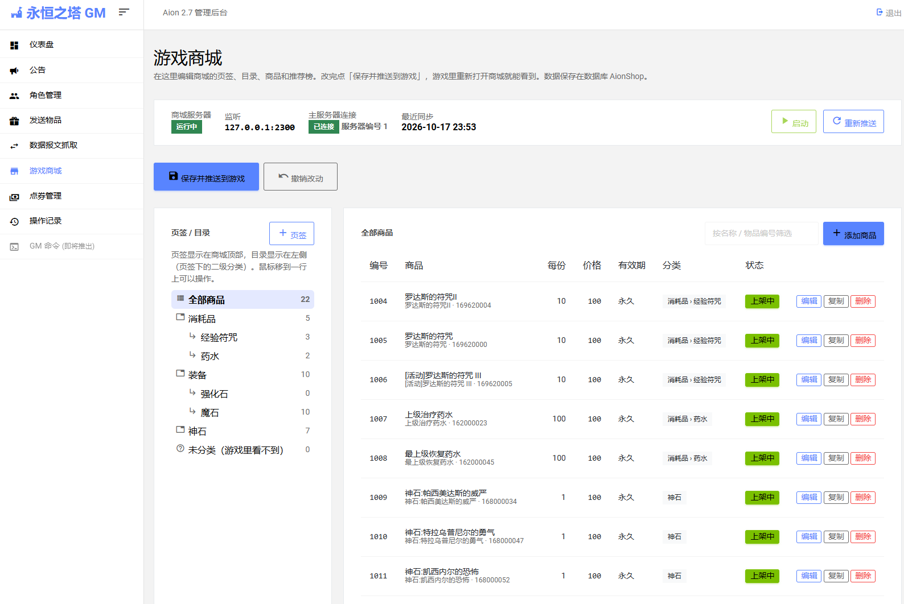
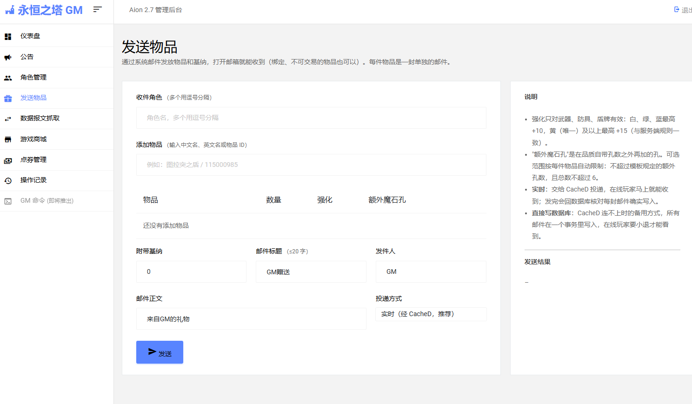

# AionWeb

**中文** | [English](README.en.md)

永恒之塔（Aion）2.7 私服的 GM 管理后台，一个 Node.js 进程顶替了原来的好几个程序：

| 原来 | 现在（本项目） |
|---|---|
| NCsoft GMServer（.NET）+ 旧版 ASP.NET 网站 | 仪表盘、公告、角色查询，直连 CacheD 管理端口和游戏数据库 |
| 独立的 GM 命令代理脚本 | 「数据报文抓取」：内置 GM 命令代理和抓包 |
| 命令行发 GM 邮件脚本 | 「发送物品」：支持强化、魔石孔，CacheD 实时投递 |
| ShopAgent + 外部计费平台（私服里没有，商城用不了） | 点券服务：余额、购买、赠送、现金道具邮件发货、断线补发 |
| 商城目录服务 | 商城服务器 + 可视化商品管理 |
| — | 自建数据库 `AionShop`：点券流水、订单、商品目录、后台操作记录 |

所有对接都按服务端原生协议实现，**不修改主服务器、CacheD 和客户端**。这些协议是通过反汇编 `Server64` / `CacheD64`（随服务端附带的 PDB 符号）得出的，见下文「协议」。

> 本项目仅供学习研究。不包含任何游戏服务端、客户端文件或从中提取的游戏数据。

---

## 功能

- **仪表盘**：各服务进程和端口状态，角色、账号统计，最近登录。
- **公告**：屏幕中央或聊天窗口，可按种族、职业筛选。走 CacheD 管理端口，实时下发。
- **角色管理**：角色列表、详情、背包、仓库、邮箱物品（强化等级、魔石孔数）。
- **发送物品**：按物品名或编号搜索，指定数量、强化等级、额外魔石孔，可附带金币，发给一个或多个角色。默认通过 CacheD 实时投递，在线玩家立即收到；会检查强化和魔石孔不超过物品上限。
- **数据报文抓取**：内置 GM 命令代理。游戏客户端连代理端口，代理把聊天里 `//` 开头的内容改写成 GM 命令，转发给主服务器；页面实时显示日志，可选记录完整数据包。
- **游戏商城**（游戏内「乌云贸易团商店」）：
  - 可视化编辑页签和二级目录，添加、编辑、复制、上下架商品，设置每份数量（不超过最大堆叠）、价格、有效期、描述，设置推荐榜 6 个位置；
  - 保存后实时推送，游戏里重新打开商城即可看到；
  - 服务器端校验：名称长度、价格、堆叠上限、两级分类、推荐榜位置等。
- **点券管理**：按账号查看余额，后台充值或扣除，在线玩家的商城窗口实时刷新；查看点券流水和商城订单（含赠送收件人）。
- **购买与赠送**：完全走游戏原生流程。扣点券后由主服务器经 CacheD 写一封现金道具邮件；主服务器确认交付后订单完成；未交付的订单在主服务器重连时自动补发。
- **操作记录**：后台的每个改动操作（登录、公告、发送物品、点券、商城目录、代理开关等）都写入数据库，可按类型查看详情，密码字段自动抹掉。
- **界面语言**：右上角「Language」切换中文 / English，选择保存在浏览器里。英文界面下物品名显示客户端的英文名，接口返回的提示和各服务的日志也跟着切换；角色名、商品名、公告内容这类数据保持原样。

## 截图

**游戏商城**：可视化编辑页签、目录、商品和推荐榜



**发送物品**：按名称或编号搜索物品，可设强化和额外魔石孔



## 架构

```
游戏客户端 ──► (GM 命令代理 7779) ──► 主服务器 Server64 ──► CacheD ──► 游戏库 AionGame
                    ▲                     │    │                ▲
                    │          商城目录 2300│    │点券/购买 2301    │ 管理端口 2007
                    │                     ▼    ▼                │
                ┌───┴──────────────── AionWeb (本项目) ───────────┴──┐
                │  HTTP 后台 8088 │ 商城服务器 │ 点券服务 │ GM 代理   │
                └────────────────────────┬───────────────────────────┘
                                         ▼
                                  自建库 AionShop
```

- 后台只连 CacheD 管理端口和数据库，不经过原来的 GMServer。
- 主服务器作为客户端，连本项目的商城服务器（拉目录）和点券服务（余额、购买）。
- 游戏库 `AionGame` 只读，或者只经由 CacheD 写入；商城和后台自己的数据都在独立的 `AionShop` 库里，不往游戏库里混数据。

## 运行环境

- Windows（服务端本身就是 Windows 程序），Node.js **22.18 以上**（推荐 24 LTS，直接运行 TypeScript，不用编译）。
- SQL Server（实测 2022），运行在 WSL 的 docker 容器里。sa 密码在运行时从容器的环境变量（`MSSQL_SA_PASSWORD` / `SA_PASSWORD`）读取，**不写进任何文件**。
- 永恒之塔 2.7 服务端（Server64、CacheD64 等），不在本仓库内。

## 安装

```bash
npm install
npm start
```

或者双击 `start_admin.bat`：第一次运行会自动安装依赖并打开浏览器。

1. 第一次启动会按默认值生成 `config.json`，参考 `config.example.json` 修改：
   - `db.dockerContainer`：SQL Server 所在的 docker 容器名；
   - `cached`：CacheD 管理端口；
   - `proxy` / `shop` / `shopAgent`：三个内置服务的监听地址和端口。
2. 生成物品缓存，见下文「物品缓存」。
3. 打开 http://127.0.0.1:8088/ ，第一次访问时设置管理密码（只存哈希，在 `data/secrets.json`）。
4. 后台默认只监听本机。

### 数据库 AionShop

启动时会自动创建 `AionShop` 库和全部表（重复执行没有副作用），并在库为空时导入 `data/shop.json` 作为初始商品目录。

`db/` 目录里有：
- `AionShop_schema.sql`：建表语句，和程序启动时执行的完全相同，用来阅读表结构；
- `AionShop.bak`：一份**脱敏后**的示例备份（SQL Server 2022）。账号名已清空，账号和角色编号重新编排，角色名改为「角色N」，操作记录已清空。还原它可以看到带订单和流水的样例数据：

```sql
RESTORE DATABASE AionShop FROM DISK = '/var/opt/mssql/backup/AionShop.bak'
  WITH MOVE 'AionShop' TO '/var/opt/mssql/data/AionShop.mdf',
       MOVE 'AionShop_log' TO '/var/opt/mssql/data/AionShop_log.ldf';
```

### 服务端配置

在 `MainServer\common.xml` 里，紧接 `cacheServerPort` 的后面加上：

```xml
<shopServerAddr>127.0.0.1</shopServerAddr>
<shopServerPort>2300</shopServerPort>
<shopAgentServerAddr>127.0.0.1</shopAgentServerAddr>
<shopAgentServerPort>2301</shopAgentServerPort>
```

主服务器只在启动时读这几项。之后后台重启时，主服务器会自己重连，不用再重启主服务器。

GM 命令代理：客户端连代理端口（默认 7779），代理转发到主服务器（7777）。注意代理在后台进程里，重启后台会断开经过代理的游戏连接。

### 物品缓存（需要自己生成）

物品名称、品质、堆叠上限、魔石孔、强化上限这些信息来自游戏数据，**仓库里不提供**，要用自己的服务端和客户端文件生成 `data/items_cache.json`（需要 Python 3）：

```bash
py tools/build_items_cache.py --items <服务端>/Map/XML/L10N/items.xml --zh <客户端中文字符串> --en <客户端英文字符串>
```

- `--zh` / `--en` 至少给一个，可以是：
  - 一个目录，里面有 `strings/*.xml`（或者直接就是这些 xml 文件）；
  - 一个标准 ZIP 格式的 `.zip` / `.pak`，里面有 `strings/*.xml`。
- 字符串文件可以是文本 XML（UTF-8 或 UTF-16），也可以是客户端的二进制 XML，脚本都能读。
- 客户端自带的语言包（`l10n/<语言>/data/Data.pak`）不是标准 ZIP，要先用 pak 工具转成 zip 或解包。
- 某种语言没给时，物品名退回服务端的内部名。

没有这个文件时后台也能启动：仪表盘会提示，角色背包里的物品显示成编号，「发送物品」和商城编辑器里的物品搜索用不了。生成之后不用重启，刷新页面即可。

## 目录

| 路径 | 说明 |
|---|---|
| `server/main.ts` | HTTP 服务、登录、接口路由、操作记录、启动流程 |
| `server/cached.ts` | CacheD 管理端口客户端（公告、发邮件） |
| `server/game.ts` | 游戏库查询：角色、背包、账号、服务状态、发送物品 |
| `server/gmproxy.ts` | GM 命令代理（客户端 ↔ 主服务器，改写聊天命令） |
| `server/shopserver.ts` | 商城目录服务（主服务器 ShopClient 的对端） |
| `server/shopagent.ts` | 点券服务（主服务器 ShopAgentClient 的对端）：余额、购买、交付、补发 |
| `server/shopdb.ts` | `AionShop` 建表、点券、订单、目录、操作记录的数据访问 |
| `server/db.ts` | SQL Server 连接池（按库名，sa 密码来自容器环境变量） |
| `server/items.ts` | 物品库：名称、品质、最大堆叠、魔石孔、强化上限 |
| `server/config.ts` | 配置加载（相对路径按项目目录解析） |
| `server/i18n.ts` | 服务端双语消息：按请求头 `X-Lang` 返回中文或英文 |
| `public/` | 前端页面；界面基于 Majestic Admin 模板 |
| `public/js/i18n.js` | 英文词典，以中文原文为键 |
| `tools/build_items_cache.py` | 生成物品缓存 `data/items_cache.json`（不在仓库里，见「物品缓存」） |
| `data/shop.json` | 初始商品目录（数据库为空时导入） |
| `db/` | 建表 SQL 和脱敏示例备份 |

## 协议

以下都是通过反汇编服务端得出、并经过实际联调验证的。

### CacheD 管理端口（2007）

```
请求: u16 长度(含自身) | u16 命令号 | u8 0xBC | u16 ~命令号 | 内容
回包: u16 长度 | u16 命令号 | u8 0xBD | u16 ~命令号 | u16 结果(0=成功)
```

- `GQ_ANNOUNCE (6)`：`u8 位置('M'/'C') | u8 类别('A'/'E') | UTF-16 文字\0 | i32 种族掩码 | i32 职业掩码`。掩码 −1 表示所有人，0 表示谁都收不到。
- `GQ_MAIL_SEND (34)`：实时投递邮件，在线玩家立即收到。

### 商城目录服务（主服务器 → 2300）

```
主服务器 → 商城: u16 len | u8 type | 0xDC | u8 ~type | 内容     0 握手(u32 serverId)  1 请求数据(u32 seq)
商城 → 主服务器: u16 len | u8 type | 0xDD | u8 ~type | 内容
  0 握手结果  1 通知更新  2 开始更新  3 商品  4 分类  5 商品-分类  6 推荐榜  7 促销  9 结束更新
  列表: u32 seq | i16 条数 | 固定长度结构体 × 条数
```

列表的**最后一包条数取负数**，主服务器只有收到负数才会建分类树。结构体长度：商品 0x248、分类 0x78、商品-分类 0x18、推荐 0x20、促销 0x28。

### 点券服务（主服务器 → 2301）

两个方向都是 `u16 总长 | u16 type | 内容`。

| type | 方向 | 内容 |
|---|---|---|
| 0x00 | 主→点券 | 协议版本（1、0x1b、serverId） |
| 0x14 | 主→点券 | 查询待交付物品；回包里列出未交付订单，主服务器会补发 |
| 0x1a | 主→点券 | 账号登录时查询点券；回包是余额 |
| 0x0c | 主→点券 | 购买（买家账号、角色、物品、每份数量、单价、角色名）；回包是结果和仓库编号 |
| 0x17 | 主→点券 | 交付确认（现金道具邮件已写好） |
| 0x1b | 点券→主 | 余额变动通知，玩家的商城窗口实时刷新 |

赠送在协议上和购买相同：主服务器先经 CacheD 按名字查收件人，再发同样的购买请求，最后把邮件发给收件人。

## 数据库表

| 表 | 用途 |
|---|---|
| `account_point` | 账号点券余额（约束：不允许为负） |
| `point_ledger` | 点券流水，只追加不修改 |
| `shop_category` / `shop_goods` / `shop_goods_category` | 商品目录（两级分类，商品可上下架） |
| `shop_ranking` / `shop_promotion` | 推荐榜（手动维护）/ 促销 |
| `shop_order` | 订单：订单号就是发给主服务器的仓库编号；带唯一请求号防止重复扣费 |
| `admin_log` | 后台操作记录 |
| `schema_meta` | 表结构版本、一次性导入标记 |

一次购买在一个数据库事务里完成：防重复检查、锁定余额、扣点券、建订单、记流水。同一个主服务器连接上的请求按到达顺序处理。

## 致谢

- 界面模板：[Majestic Admin](https://github.com/BootstrapDash/MajesticAdmin-Free-Bootstrap-Admin-Template)（MIT）。
- NCsoft 原版 ShopAgent 的发货仓库表设计（买家和收件人分开记、外部请求号防重复）给了不少参考。
